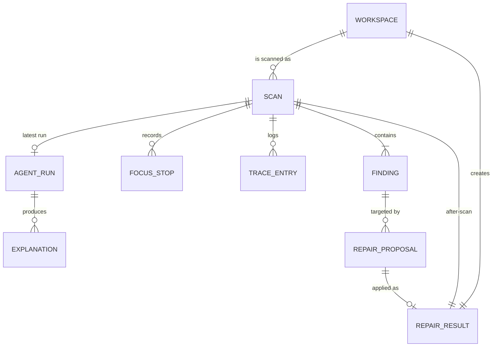

# AccessPilot — Data Model

Source of truth for stored data. Product scope: `PRD.md`. System design: `ARCHITECTURE.md`.

## 1. Decision

✅ **MVP (hackathon): no database.** All records live in memory (`backend/app/store.py`) for the lifetime of the server process. Demo working copies live on disk in a temporary directory.

Reasons: the product is a single-user local tool; every user journey happens in one session; the PRD requires that page source is not persisted; and removing a database removes setup risk at the venue.

❓ **Decision needed (P1, only if scan history is requested):** adopt **SQLite** (one file, `backend/data/accesspilot.db`, stdlib `sqlite3`, no ORM) using the schema in §4. Postgres and row-level security apply only to a future hosted, multi-user version (§9).

## 2. Current in-memory model (implemented)

| Store | Key | Value | Written by | Read by |
|-------|-----|-------|-----------|---------|
| `scans` | `scanId` | `Scan` | `scanner.run_scan` | API, agent, fixer, verifier, export |
| `proposals` | `proposalId` | `RepairProposal` | `fixer.service.propose` | apply, export |
| `results` | `proposalId` | `ApplyResult` | `fixer.service.apply` | export |
| `agent_runs` | `scanId` | `AgentRun` (latest only) | `agent.runner` | export |
| `screenshots` | `scanId` | JPEG bytes of the page as scanned | `scanner._capture` | `GET /api/scans/{id}/screenshot` only |
| `workspace._dirs` | workspace id | `Path` | `workspace.create_from` | static route, verifier |
| `verifier._control_cache` | workspace id | control-page `Scan` | verifier | verifier |

Ids: `scan_<10 hex>`, `prop_<10 hex>`, `ws<8 hex>`, plus `original` for the bundled demo.

Findings, focus stops, explanations, trace entries and coverage are **embedded** in their parent `Scan` and `AgentRun`; they have no independent lifecycle.

## 3. Entities and relationships

- A proposal belongs to the scan it was proposed from and references one finding by fingerprint.
- A result creates exactly one new workspace and one after-scan of it.
- A workspace's parent is the workspace of the before-scan (`original` for the bundled demo).

## 4. Relational schema (P1, SQLite — not yet implemented)

Types are SQLite affinities; timestamps are ISO-8601 UTC text; JSON columns hold arrays that are always read whole.

### `workspaces`
| Column | Type | Constraints |
|--------|------|-------------|
| `id` | TEXT | PK; `original` or `ws` + 8 hex |
| `parent_id` | TEXT | FK → workspaces.id, NULL for `original` |
| `path` | TEXT | NOT NULL; absolute path under the workspace root |
| `created_at` | TEXT | NOT NULL |
| `expires_at` | TEXT | NULL = keep (for TTL cleanup) |

### `scans`
| Column | Type | Constraints |
|--------|------|-------------|
| `id` | TEXT | PK (`scan_…`) |
| `workspace_id` | TEXT | FK → workspaces.id, NULL for external targets |
| `requested_url` | TEXT | NOT NULL, ≤ 2048 |
| `final_url` | TEXT | NOT NULL |
| `title` | TEXT | ≤ 300 |
| `status` | TEXT | CHECK IN ('completed','partial','failed') |
| `repairable` | INTEGER | CHECK IN (0,1) |
| `scanner_version` | TEXT | NOT NULL |
| `passes_count` | INTEGER | ≥ 0 |
| `duration_ms` | INTEGER | ≥ 0 |
| `keyboard_ended_reason` | TEXT | |
| `keyboard_truncated` | INTEGER | CHECK IN (0,1) |
| `coverage_json` | TEXT | NOT NULL (methods, tags, notTested) |
| `trace_json` | TEXT | NOT NULL |
| `created_at` | TEXT | NOT NULL |

### `findings`
| Column | Type | Constraints |
|--------|------|-------------|
| `id` | INTEGER | PK autoincrement |
| `scan_id` | TEXT | FK → scans.id ON DELETE CASCADE, NOT NULL |
| `kind` | TEXT | CHECK IN ('violation','incomplete') |
| `fingerprint` | TEXT | NOT NULL |
| `match_key` | TEXT | NOT NULL (`rule|target`) |
| `source` | TEXT | CHECK IN ('axe','keyboard-heuristic','ai-advice') |
| `rule_id` | TEXT | NOT NULL |
| `impact` | TEXT | CHECK IN ('critical','serious','moderate','minor') OR NULL |
| `help` / `description` / `help_url` | TEXT | |
| `tags_json` / `wcag_json` | TEXT | |
| `target` | TEXT | NOT NULL |
| `snippet` | TEXT | length ≤ 300 |
| `failure_summary` | TEXT | length ≤ 600 |
| `repair_template` | TEXT | NULL or 'T1'..'T5' |
| `needs_human_review` | INTEGER | CHECK IN (0,1) |
| | | UNIQUE (`scan_id`, `kind`, `fingerprint`) |

### `focus_stops`
| Column | Type | Constraints |
|--------|------|-------------|
| `scan_id` | TEXT | FK → scans.id ON DELETE CASCADE |
| `step` | INTEGER | 1–30 |
| `selector` / `tag` / `role` / `name` | TEXT | name ≤ 80 |
| `tab_index` | INTEGER | |
| `repeated` | INTEGER | CHECK IN (0,1) |
| | | PK (`scan_id`, `step`) |

### `agent_runs`
| Column | Type | Constraints |
|--------|------|-------------|
| `id` | INTEGER | PK |
| `scan_id` | TEXT | FK → scans.id ON DELETE CASCADE |
| `ai_used` | INTEGER | CHECK IN (0,1) |
| `model` | TEXT | |
| `fallback_reason` | TEXT | |
| `explanations_json` / `needs_human_json` / `trace_json` | TEXT | |
| `created_at` | TEXT | |

### `repair_proposals`
| Column | Type | Constraints |
|--------|------|-------------|
| `id` | TEXT | PK (`prop_…`) |
| `scan_id` | TEXT | FK → scans.id ON DELETE CASCADE |
| `fingerprint` | TEXT | NOT NULL; must exist in `findings` for that scan (checked in code) |
| `template` | TEXT | NULL or 'T1'..'T5' |
| `status` | TEXT | CHECK IN ('suggested','applied','verified','partially_verified','failed','needs_human') |
| `rationale` | TEXT | ≤ 600 |
| `risk` | TEXT | CHECK IN ('low','medium','high') |
| `diff` | TEXT | |
| `params_json` | TEXT | |
| `approval_token_hash` | TEXT | SHA-256 of the token; NULL once used |
| `proposed_by` | TEXT | CHECK IN ('ai','deterministic','user') |
| `created_at` | TEXT | |

### `repair_results`
| Column | Type | Constraints |
|--------|------|-------------|
| `proposal_id` | TEXT | PK, FK → repair_proposals.id |
| `status` | TEXT | same CHECK as proposals minus 'suggested' |
| `reason` | TEXT | |
| `after_scan_id` | TEXT | FK → scans.id, NULL if the patch did not apply |
| `workspace_id` | TEXT | FK → workspaces.id |
| `comparison_json` / `control_gate_json` | TEXT | |
| `approved_by` | TEXT | ≤ 60 |
| `approved_at` | TEXT | NOT NULL |

## 5. Indexes (from real queries)

| Query | Index |
|-------|-------|
| Findings of a scan (results view, compare, export) | covered by UNIQUE (`scan_id`, `kind`, `fingerprint`) |
| Compare by match key | `findings(scan_id, match_key)` |
| Proposals of a scan (export) | `repair_proposals(scan_id)` |
| Latest agent run of a scan | `agent_runs(scan_id, created_at DESC)` |
| Scan history list (newest first) | `scans(created_at DESC)` |
| Workspace cleanup | `workspaces(expires_at)` |

No other indexes until a measured query needs one.

## 6. Constraints and validation

Validation happens in Pydantic models first (types, enums, `confidence` 0–1, URL length ≤ 2048) and in code (fingerprint belongs to scan, template parameters match their regex). The database CHECK constraints repeat the enums as a second line of defence. `PRAGMA foreign_keys = ON` on every connection.

## 7. Ownership and authorisation

- MVP and SQLite: single local user; the process owns all rows.
- Hosted future: add `users(id, github_id, created_at)` and `owner_id` on `scans` (proposals, results and runs inherit through `scan_id`). Every query filters by owner in the service layer.

## 8. Sensitive data handling

| Data | Rule |
|------|------|
| Page source | Never stored; only snippets ≤ 300 chars and failure summaries ≤ 600 chars |
| Page capture | A JPEG of the page as rendered, in memory only for the evidence view; never written to disk, exported or sent to a model. If scans are persisted (P1), captures stay out of the database or get a short TTL |
| Approval tokens | In memory: plain, single use, cleared after apply, excluded from export. In SQLite: store only the SHA-256 hash |
| API keys | Environment only; never in any table, log or export |
| URLs | Stored as given; may contain query strings, so the export warns users before sharing (P1) |
| Model output | Stored as advice, labelled `generatedBy: ai` |

## 9. Row-level security

Not applicable to SQLite or the single-user MVP. If moved to Postgres for a hosted version: enable RLS on `scans` with a policy `owner_id = current_setting('app.user_id')`, and child tables join through `scan_id`.

## 10. Migrations and seed data

- Migrations: numbered plain SQL files `backend/migrations/0001_init.sql`, …, applied at startup in order, tracked in `schema_migrations(version, applied_at)`. Forward-only; never edit an applied file.
- Seed: none needed. The Golden Site and control page (`demo/`) are the seed fixtures and are versioned in git.

## 11. Backup and recovery

- MVP: nothing to back up; a restart is the recovery. The `demo/` folder is in git.
- SQLite: the database is disposable demo history. If kept, copy the `.db` file while the server is stopped, or use `sqlite3 .backup`. Retention: delete scans older than 30 days together with their workspaces.
